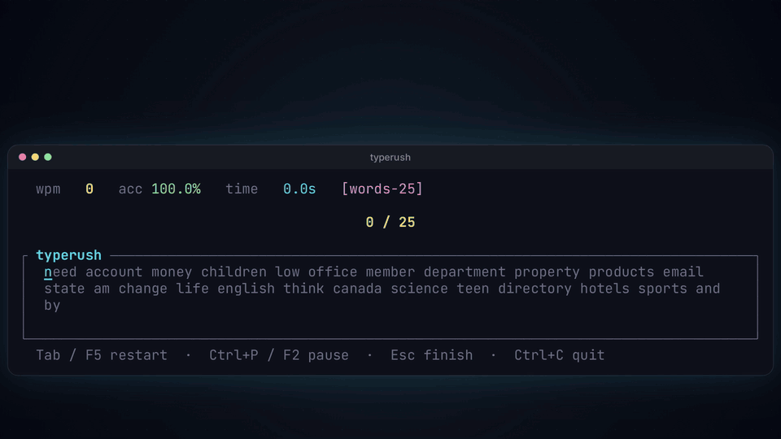

# TypeRush

**Type faster. Right in your terminal.**

[](https://crates.io/crates/typerush)
[](LICENSE)
[](https://github.com/withrvr/typerush/actions/workflows/ci.yml)

```
████████ ██    ██ ██████  ███████ ██████  ██    ██ ███████ ██   ██
   ██     ██  ██  ██   ██ ██      ██   ██ ██    ██ ██      ██   ██
   ██      ████   ██████  █████   ██████  ██    ██ ███████ ███████
   ██       ██    ██      ██      ██   ██ ██    ██      ██ ██   ██
   ██       ██    ██      ███████ ██   ██  ██████  ███████ ██   ██
```

## 🎬 Launch video

<a href="docs/brag/brag.mp4"></a>

The clip above loops silently. **[▶ Watch it with sound (MP4, 23s)](docs/brag/brag.mp4)**

---

## 👀 Preview


TypeRush is a beautiful, fast typing-speed trainer that runs **entirely in your terminal**.
No browser. No internet. No installer. Just one tiny binary, ready in a single command.

Whether you want to break your personal best, practise code typing, or just unwind
with a quote — TypeRush meets you where you already work: the command line.

---

## ✨ Why TypeRush

- 🚀 **Instant feedback** — see your WPM and accuracy climb keystroke by keystroke
- 🎯 **Honest scoring** — every character counts, the space between words included
- 🖱 **Keyboard or mouse** — arrow-key menu, or click any option and footer hint
- 🎨 **Themes built-in** — `dark`, `light`, `monokai`, `dracula`, or roll your own colors
- ⏱ **Eight built-in modes** — Time, Words, Quote, Code, Symbols, Zen, Custom-file, and a Daily challenge
- 📅 **Daily challenge** — the same 40 words for everyone on a given day, with today's best
- 🔁 **Replay any session** — type the exact same words again and see how you compare
- ⏸ **Pause** — `Ctrl+P` / `F2` stops the clock and hides the text
- 📊 **A chart of every run** — WPM, raw speed and mistakes second by second, plus raw WPM, consistency and a correct / incorrect / missed breakdown
- 🏅 **Levels, XP and a profile** — earn XP for time typed, see your bests side by side and a year of practice on an activity calendar
- 🔤 **Seven code languages** — Rust, Python, JavaScript, Go, Java, SQL, Shell
- 📚 **10k-word pool & punctuation/number drills** — toggle them with `b` / `p` / `n` in the menu when you want a tougher session
- 🗂  **Personal snippet library** — drop `.txt` files in `~/.typerush/snippets/`, each with its own personal best
- 💾 **Tracks your progress** — every session saved locally, with charts and a personal best; export it as CSV
- ⚙️ **Settings without a text editor** — an in-app Settings screen, or `typerush config set …`
- 🌍 **Runs everywhere** — Linux · macOS · Windows · WSL · Git Bash
- 📦 **One binary, zero setup** — `cargo install typerush` and you're done

---

## 🚀 Install

```bash
cargo install typerush
```

That's it. Run `typerush` and start typing.

> Don't have Rust? Install it in 30 seconds: [https://rustup.rs](https://rustup.rs)

Pre-built binaries for Linux, macOS, and Windows are also available on the
[Releases page](https://github.com/withrvr/typerush/releases) — download, unzip, run.

---

## 🎮 Quick start

Open the interactive menu:

```bash
typerush
```

Or jump straight into a mode:

```bash
typerush --time 30            # 30-second timed sprint
typerush --words 50           # 50 random English words
typerush --quote              # one programming quote
typerush --code rust          # rust | python | js | go | java | sql | shell
typerush --symbols 25         # programming-punctuation drill
typerush --daily              # today's daily challenge
typerush --replay             # type your last session again, word for word
typerush --zen                # zen mode — no timer, no pressure
typerush --file my_text.txt   # type anything you want
typerush --big                # use the 10,000-word English pool
typerush --punctuation        # sprinkle punctuation onto random words
typerush --numbers            # mix number tokens into random words
typerush --no-punctuation     # plain run, even if your config turns it on
typerush --theme monokai      # try a different theme
typerush --list-themes        # see all built-in themes
typerush --list-snippets      # see every snippet in ~/.typerush/snippets/
```

And a few things that don't open the app:

```bash
typerush export stats.csv             # your history as CSV (leave out the file to print it)
typerush config show                  # every setting, and the value in use
typerush config set theme dracula     # change one (your comments in the file are kept)
typerush --init-config                # write a starter ~/.typerush/config.toml
```

---

## 🎯 Modes at a glance

| Mode    | What it's for                                                       |
| ------- | ------------------------------------------------------------------- |
| Time    | Sprint! Type as many words as you can in 15/30/60/120s              |
| Words   | Hit a fixed target — 10, 25, 50, or 100 words                       |
| Quote   | Famous programming quote, one round                                 |
| Code    | Real Rust / Python / JS / Go / Java / SQL / Shell snippets          |
| Symbols | Drill punctuation: `(){};=>`, `&&`, `?.`, `<T>` and friends         |
| Zen     | No timer, no score. Just type and breathe.                          |
| Custom  | Any text file via `--file` or `.txt` in `~/.typerush/snippets/`     |
| Daily   | Today's 40 words — the same for everyone, new every day             |

---

## ⌨️ A few keys to know

| Key             | Action                          |
| --------------- | ------------------------------- |
| `Enter`         | start / restart a session       |
| `Esc`           | back to menu / end session      |
| `Ctrl+R` / `F5` | restart the current mode        |
| `Ctrl+P` / `F2` | pause / resume while typing     |
| `Tab`           | jump to your stats history      |
| `c`             | settings (from the menu)        |
| `u`             | profile (from the menu)         |
| `?` / `F1`      | open the keybindings overlay    |
| `Ctrl+C`        | quit                            |

The mouse works too: click a menu option, a stats row, a setting's `‹ ›`, or
any footer hint.

Full keymap: see [`docs/USAGE.md`](docs/USAGE.md).

---

## 📈 Track your progress

Every (non-zen) session is saved to `~/.typerush/stats.json`. The Stats screen
shows your personal best, average accuracy, a trend sparkline, and every run
in a scrolling list — plus, as of v0.3:

- 🔥 **Daily streak** — consecutive days you've practiced
- 📅 **7- and 30-day WPM averages**
- ⌨️ **Per-key accuracy heatmap** — find the keys that slow you down
- 🏅 **Per-mode personal bests** — a separate record for `time-30s`, `words-50`, etc.

And as of v0.4.1, **stats by category**: flip through every mode with `←` / `→`
to see its own summary, trend and full session list, or a table of your best
in every mode — with a ★ on each record-holding run.

New in v0.5: pick any session in the list and press `Enter` to **replay it
word for word** (Results then shows how you did against the original), and
press `e` to **export your history as CSV**.

New in v0.6:

- 📊 **Results chart** — the run second by second: WPM, raw speed, and a
  dot for every mistake; with **raw WPM**, **consistency** (how even your
  pace was) and **correct / incorrect / missed** characters
- 🔎 **Filter and sort your history** — by date range (`d`), word settings
  (`w`), and sort by WPM, raw, accuracy, consistency or time (`s`, `r`)
- 🏅 **Profile** (`u` in the menu) — your **level and XP** (one XP per
  second typed), runs started vs completed, time and keys typed, your best
  for every time and word count side by side, and an **activity calendar**
  of the last year

---

## 🎨 Make it yours

Open **Settings** from the menu (`c`) to pick a theme — it changes as you
pick — the mode the menu starts on, and the word settings; they're saved to
`~/.typerush/config.toml` straight away. Or from the shell:

```bash
typerush config set theme monokai
typerush config set defaults.time_seconds 30
```

`typerush --init-config` writes a starter [`config.toml`](config.example.toml)
with every setting explained, and you can also edit it by hand:

```toml
theme = "monokai"

[defaults]
mode = "time"
time_seconds = 30
```

See [`docs/USAGE.md`](docs/USAGE.md#configuration--typerushconfigtoml) for
the full reference.

---

## 📚 More documentation

- 📖 [USAGE](docs/USAGE.md) — all keybindings, modes, CLI flags, config
- 🏛 [ARCHITECTURE](docs/ARCHITECTURE.md) — how the code is laid out
- 🛠 [DEVELOPMENT](docs/DEVELOPMENT.md) — local dev workflow, cargo-watch, sandbox config
- 🗺 [ROADMAP](docs/ROADMAP.md) — what's done, what's next
- 🤝 [CONTRIBUTING](CONTRIBUTING.md) — dev setup, conventions, how to help
- 📝 [CHANGELOG](CHANGELOG.md) — what changed in every release

---

## 💬 Get involved

- 🐞 Found a bug? [Open an issue](https://github.com/withrvr/typerush/issues/new/choose)
- 💡 Got an idea? [Request a feature](https://github.com/withrvr/typerush/issues/new/choose)
- ❤️ Like the project? Give it a star — it really helps!

---

## License

[MIT](LICENSE)
