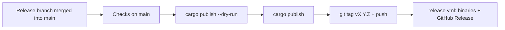

# Release Guide

How to cut a TypeRush release: publish it to
[crates.io](https://crates.io/crates/typerush) and tag it, which builds the
download binaries. `X.Y.Z` below is the version you're shipping.



---

## 1. Before you merge

Everything for the release lands on `main` through the version's pull
request:

- `Cargo.toml` has `version = "X.Y.Z"`, and `Cargo.lock` matches it.
- `CHANGELOG.md` has a `## [X.Y.Z] — <title>` section, with
  `[Unreleased]` left empty above it. `release.yml` copies that section
  into the GitHub Release, so its heading must match exactly.
- The README, [USAGE](USAGE.md) and the launch video
  ([`docs/brag/`](brag/README.md)) describe this version.
- CI is green on the pull request.

---

## 2. Checks on `main`

```bash
git checkout main
git pull
git status                     # clean, nothing ahead or behind
git tag -l "vX.Y.Z"            # nothing: the tag doesn't exist yet

cargo fmt --all -- --check
cargo clippy --all-targets --locked -- -D warnings
cargo test --all-targets --locked
cargo +1.88.0 check --locked
cargo build --release --locked
```

Then try the release binary with a throwaway `HOME`, so your real
`~/.typerush` isn't touched (see
[end-to-end testing in tmux](DEVELOPMENT.md#end-to-end-testing-in-tmux)):

```bash
HOME=/tmp/tr-release ./target/release/typerush
```

Run a test to the end, open Stats and Settings, and try whatever this
release changed. A finished run must land in
`/tmp/tr-release/.typerush/stats.json`, and `--replay` must find it.

---

## 3. Package check

```bash
cargo package --list --locked   # every file that will be uploaded
cargo publish --dry-run --locked
```

The list should hold `Cargo.toml`, `Cargo.lock`, `README.md`, `LICENSE`,
`CHANGELOG.md`, `config.example.toml` and `src/**` — and no `docs/`,
`.github/`, `.claude/`, `*.mp4` or `*.gif`. The crate should be a few
hundred KB; if it's megabytes, `exclude` in `Cargo.toml` is missing a path.

---

## 4. Publish to crates.io

```bash
cargo login        # only once per machine
cargo publish --locked
```

> **This can't be undone.** A published version can never be changed or
> uploaded again. `cargo yank --version X.Y.Z` only stops new projects from
> picking it up.

---

## 5. Tag it

```bash
git tag -a vX.Y.Z -m "TypeRush vX.Y.Z"
git push origin vX.Y.Z           # only this tag, not --tags
gh run watch                     # the Release workflow
```

Pushing the tag starts [`release.yml`](../.github/workflows/release.yml). It
builds `typerush` for Linux, macOS (Intel and Apple chips) and Windows, and
creates the GitHub Release with those archives and the changelog section.
Don't create the release by hand — the workflow does.

---

## 6. Check it

- `cargo search typerush --limit 1` shows `X.Y.Z`.
- <https://crates.io/crates/typerush>: the version, README and video show.
- The [latest release](https://github.com/withrvr/typerush/releases/latest)
  has four archives and the changelog notes.
- `cargo install typerush --force` installs and runs.

---

## Why publish before tagging

A failed `cargo publish` (a metadata problem, a name check, a network
error) leaves nothing public: fix it on `main` and run it again. Only once
the crate is live does the tag go up, so every GitHub Release, and every
download it offers, matches a version people can `cargo install`.

If the Release workflow fails for a passing reason (a runner hiccup),
re-run it from the Actions tab. If the workflow itself needs a fix, fix it
on `main`, then move the tag to that commit and push it again:

```bash
git push origin :refs/tags/vX.Y.Z && git tag -d vX.Y.Z
git tag -a vX.Y.Z -m "TypeRush vX.Y.Z" && git push origin vX.Y.Z
```

The crate on crates.io stays as it is.
