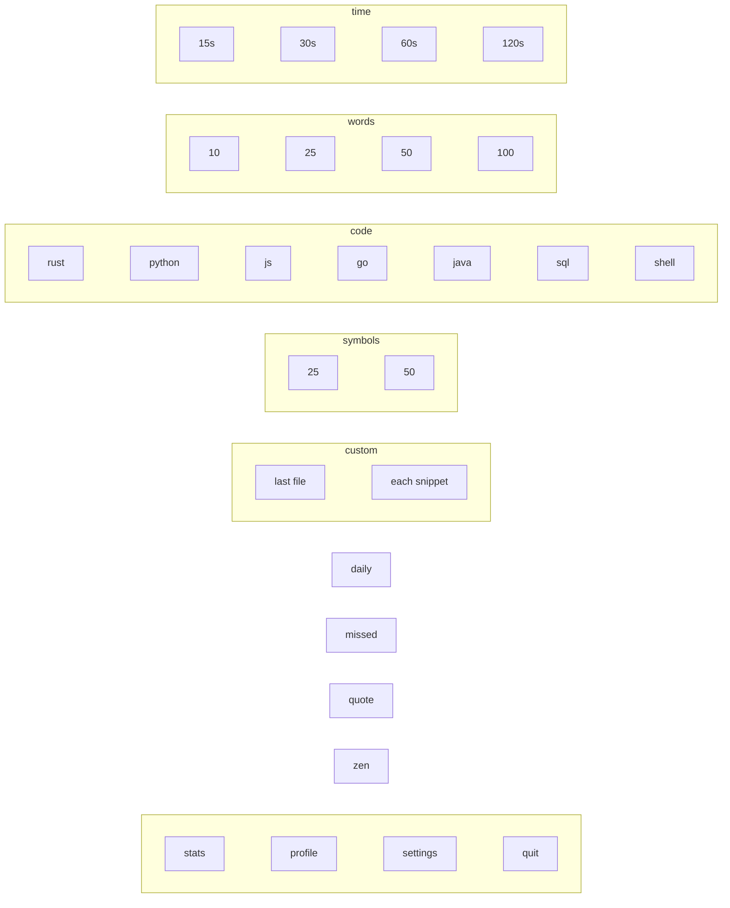
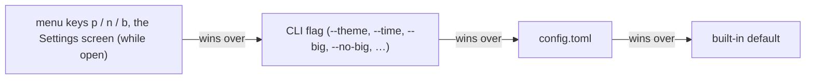

# TypeRush — Usage Guide

Everything you can do with TypeRush, in one place.

---

## Running it

Open the interactive menu:

```bash
typerush
```

Or skip the menu and start a session directly:

```bash
typerush --time 30            # 30-second timed test (15 / 30 / 60 / 120)
typerush --words 50           # type exactly N words
typerush --quote              # one programming quote
typerush --code rust          # code: rust | python | js | go | java | sql | shell
typerush --zen                # zen mode (no timer, no stats)
typerush --symbols 25         # programming-symbols drill of N tokens
typerush --daily              # today's daily challenge
typerush --missed             # practise the words you've got wrong lately
typerush --replay             # type the last saved session again, word for word
typerush --replay 3           # …or the third most recent one
typerush --file <path>        # type any text file you have
typerush --theme monokai      # one-shot theme override
typerush --list-themes        # print available theme names and exit
typerush --list-snippets      # print your snippets (name<TAB>path) and exit
```

Counts must be at least 1 (`--replay N` too, and at most the number of
sessions you have saved): `--time` goes up to 3600 seconds, `--words` and
`--symbols` up to 10,000 (the same limits apply to `time_seconds`,
`word_count` and `symbol_count` in the config). A custom file (`--file` or a snippet) must be a
regular UTF-8 text file of at most 1 MiB.

These switches make random words harder, and combine with any of the above
(they apply to time and words modes; zen always stays plain):

```bash
typerush --big                # 10,000-word pool instead of the ~430 common words
typerush --punctuation        # commas, periods, quotes, brackets on ~1 word in 4
typerush --numbers            # mix in 1–4 digit numbers (~1 word in 8)
typerush --no-punctuation     # off for this run, even if config.toml turns it on
```

Each has a `--no-` twin (`--no-big`, `--no-punctuation`, `--no-numbers`) for a
plain run when your config turns it on; if both are given, the last one wins.
In the menu, `p`, `n` and `b` toggle the same three settings (see
[Main menu](#main-menu)).

`--code` also accepts `rs`, `py`, `javascript`, `golang`, `sh` and `bash`.

### Your own text: `--file`, snippets, and the custom row

- `typerush --file notes.txt` starts typing that file straight away.
- Drop `.txt` files in `~/.typerush/snippets/` (on Windows,
  `%USERPROFILE%\.typerush\snippets\`) and each becomes an option in the
  menu's **custom** row, named after the file.
- The file you typed last — from `--file` or a snippet — is offered first in
  the custom row next time, so you don't need `--file` again. It is remembered
  in `~/.typerush/state.json` as an absolute path, and only once it has loaded.
- With no file and no snippets yet, the custom row shows `custom`; picking it
  explains how to add one.
- Each file keeps its own personal best: a session is saved as `custom-`
  plus the file name without its extension (`custom-notes` for `notes.txt`),
  so a five-word drill never sets the bar for a long essay.
- Every option in the row has a different label: long names are shortened in
  the middle (`quarterly-r…nal-draft-q1`), two snippets with the same name
  show their full file names, and a remembered file whose name a snippet
  already uses shows its folder too (`me/notes.txt`).

Text is split on whitespace, so a file's line breaks become plain spaces.

### Things that don't open the app

```bash
typerush export               # print your session history as CSV
typerush export stats.csv     # …or write it to a file (replaced if it exists)
typerush config path          # where config.toml is
typerush config show          # every setting with the value TypeRush uses
typerush config get theme     # one setting's value
typerush config set theme dracula
typerush config reset theme   # one setting back to its default
typerush config reset         # every setting back to its default
typerush --init-config        # write a starter config.toml (same as `config init`)
```

See [Exporting your history](#exporting-your-history) and
[Changing settings](#changing-settings) for the details. These can't be
combined with the run flags above (`typerush --time 30 export` is refused).

---

## Modes in detail

| Mode    | Description                                                          | Ends when…                       |
| ------- | -------------------------------------------------------------------- | -------------------------------- |
| Time    | Sprint — type as many words as possible in N seconds                  | the timer hits zero              |
| Words   | Type a fixed number of random words (10 / 25 / 50 / 100)              | you complete the last word       |
| Quote   | A randomly chosen famous programming quote                            | you complete the last word       |
| Code    | A real short code snippet (Rust, Python, JavaScript, Go, Java, SQL, Shell) | you complete the last word  |
| Zen     | Soft, monochrome UI. No timer, no WPM, no score saved.                | you press `Esc`                  |
| Symbols | Programming punctuation: `=>`, `(){};`, `&&`, `?.`, `<T>` … (25 / 50 tokens) | you complete the last token |
| Custom  | A text file: `--file`, a snippet, or the file you typed last          | you complete the last word       |
| Daily   | Today's challenge: 40 words, the same for everyone on a given day      | you complete the last word       |
| Missed  | The words you've got wrong lately, shuffled (at least 25)             | you complete the last word       |

### The daily challenge

The `daily` menu row (or `--daily`) gives 40 words from the 10,000-word
pool, about one in five ending in a comma or a period. The words come from
the date alone: everyone gets the same text on the same calendar day (their
own, local day), and it changes at midnight. The `p` / `n` / `b` settings
don't apply — that would change the text.

You can play it as often as you like. On Results its best is **today
best**: only earlier runs of today's words count, so a hard day isn't
measured against an easy one. In Stats every daily run is in the `daily`
category.

(The words depend on the date and on TypeRush's word list, so two
different versions of TypeRush could give different words on the same day.)

### Practising missed words

Every session keeps the words you got wrong — a word counts when you
pressed a wrong key in it or on its space, even if you fixed it. The
`missed` menu row (or `--missed`, or `mode = "missed"` to start on it)
builds a run from them: from your last 100 sessions, the 50 words you've
missed most often (the most recent first when two tie), shuffled and
repeated so the run has at least 25 words. It's saved as `missed`, with its
own best. Sessions keep their missed words from TypeRush 0.7 on; before you
have any, it says so.

### Replaying a session

Every session is saved with the words it typed (every word of a words,
quote, code, symbols, custom or daily run; the words you reached in a time
run). Pick one on the Stats screen and press `Enter` — or run `typerush
--replay N` — to type exactly those words again:

- It ends the way the original did: a time run when the clock runs out
  (with fresh words, played the same way, if you get past where the
  original stopped), anything else on its last word.
- It is saved as the original's mode plus `+replay` (`time-30s+replay`),
  so typing words you have seen before never sets your real best.
- Results shows your WPM against the original run's (`+12 vs original`)
  and when the original was played.
- `Enter` / `F5` / `Ctrl+R` replays it again; anything picked in the menu
  is a normal run.

Sessions saved before TypeRush 0.5 have no words kept, so they can't be
replayed. Neither can a run whose text was longer than 64 KiB (a big custom
file), so `stats.json` stays small.

---

## Keybindings

### Everywhere

| Key          | Action                                                  |
| ------------ | ------------------------------------------------------- |
| `?` / `F1`   | Toggle keybindings overlay (not while typing)           |
| `Ctrl+C`     | Quit immediately                                        |

### Mouse

Everything the mouse can do, the keyboard can do too (WCAG 2.1.1), and vice
versa where it makes sense:

- **Click a menu option** to start it (or open stats, profile, settings /
  quit).
- **Click a footer hint** (`Enter start`, `s stats`, `esc finish`, …) to do
  what its key does. Navigation hints like `↑/↓ category` are not clickable.
- **Click a row** of the Stats lists to select it (`Enter replay` then
  replays it), and the **filter chips** under it (`d dates`, `w words`,
  `s sort`, `r reverse`) to change them. In Settings **click `‹` / `›`** to
  change a value or the value itself for the next one; on the Profile
  calendar **click a day** to see it.
- **Scroll wheel** on the menu moves between categories; on Stats and
  Settings it moves the selection.
- **Click anywhere** to close the help overlay or an error message.

A click acts when the button is pressed *and* released on the same target:
press on the wrong option, slide off (or onto another option), and nothing
happens (WCAG 2.5.2).

Because TypeRush captures the mouse, selecting text in the terminal usually
needs `Shift` held while dragging.

### Main menu

Modes are grouped by category, the ones with a choice of options first:
`time`, `words`, `code`, `symbols` and `custom` show a heading with their
options on the line below (a row too wide for the menu continues on the next
line). Then come the single runs `daily`, `missed`, `quote` and `zen`, and
`stats`, `profile`, `settings` and `quit` share the last row:



The bottom border of the list shows the three word settings — `p
punctuation`, `n numbers`, `b 10k words` — each spelled out as `on` or `off`
and clickable. They apply to time and words runs, whose saved label follows
them (`time-30s+p`).

The menu is laid out like every other screen: a title row, then one
full-width box with the TypeRush banner at its top and the modes centered
below it. It
fits itself to the terminal. With room to spare it shows the big banner and
a blank line between categories. On a standard 80×24 terminal it switches
to a two-line banner and, when the blank lines between categories don't all
fit, leaves them all out (never a mix), so every option is on screen at
launch. Only on a terminal too short
for the whole list does it scroll, and then the border shows `▲ more` /
`▼ more`.


| Key                | Action                                         |
| ------------------ | ---------------------------------------------- |
| `↑ / ↓` or `j / k` | Previous / next category (keeps the column)    |
| `← / →` or `h / l` | Previous / next option in the category         |
| `Enter` / `Space`  | Start the selected mode                        |
| `p`                | Punctuation on / off (time and words runs)     |
| `n`                | Numbers on / off (time and words runs)         |
| `b`                | 10k-word pool on / off (time and words runs)   |
| `Tab` / `s`        | Jump to the historical stats view              |
| `c`                | Settings                                       |
| `u`                | Profile                                        |
| `q`                | Quit                                           |

### While typing

| Key              | Action                                          |
| ---------------- | ----------------------------------------------- |
| any printable    | Type that character                             |
| `Space`          | Type a space — correct only where the text has one |
| `Backspace`      | Delete the previous character                   |
| `Ctrl+Backspace` | Delete the entire current word (`Alt+Backspace` too) |
| `Ctrl+W`         | Same — delete the entire current word            |
| `Ctrl+H`         | Same — most terminals send this when you press `Ctrl+Backspace` |
| `Tab` / `F5` / `Ctrl+R` | Restart the same mode with a new word list (a replay: the same words) |
| `Ctrl+P` / `F2`  | Pause / resume                                  |
| `Esc`            | End the session and go to the results screen    |

**Paused**, the clock stands still and the words are hidden (no reading
ahead on a stopped clock). Keys you type are ignored until you resume with
`Ctrl+P` / `F2`; `Esc` still finishes the run and `Ctrl+R` / `F5` still
restart it. Paused time never counts: not towards WPM, a time run's clock,
or the time saved in your stats.

### Results screen

| Key             | Action                            |
| --------------- | --------------------------------- |
| `Enter` / `F5` / `Ctrl+R` | Restart the same mode   |
| `F6`            | The same words again (a replay of this run) |
| `Tab`           | Open the stats history            |
| `Esc`           | Back to the menu                  |
| `F1`            | Help                              |
| `Ctrl+C`        | Quit                              |

Only keys you never press while typing work here: if you're still typing
when the run ends, those last letters, spaces and `?` are ignored instead of
skipping past your results.

What Results shows:

- The title row: `✓ session complete`, then the XP the run earned and your
  level (`+31 xp · level 7 · 62%`), or `★ level 8!` when it took you up a
  level (see [Levels and XP](#levels-and-xp)).
- **wpm** (with `+3 vs last`, or `vs original` for a replay), **raw wpm**
  — every key typed, right or wrong, so the gap to wpm is what the mistakes
  cost — **accuracy**, **consistency**, **time**.
- **chars**: keys typed right · keys typed wrong · characters of the text
  you never reached (a fixed text ended early with `Esc`; a time run misses
  nothing).
- **mode** and its best (`today best` for the daily challenge).
- **A chart of the run, second by second**: the WPM so far (the line that
  ends at your WPM), the raw speed of each second, and a dot on each second
  with a mistake. Both axes are labelled on round numbers — at least four
  labels each, more on a bigger terminal. Runs under two seconds, and zen,
  have no chart.

**Consistency** is how even your speed was: 100% means the same number of
keys every second. It is 100 minus how far the keys per second spread from
their average, as a percentage of that average (a second with no keys
counts, so stopping to think lowers it). Runs under two whole seconds have
none.

### Stats history

| Key                         | Action                                       |
| --------------------------- | -------------------------------------------- |
| `←` / `→` (`h` / `l`)       | Previous / next category                     |
| `a`                         | All sessions                                 |
| `↑` / `↓` (`k` / `j`)       | Select a session (or a mode on the bests table); the list scrolls with it |
| `PgUp` / `PgDn`, `Home` / `End` | Move by ten / to the newest or oldest    |
| `Enter`                     | Replay the selected session (on bests: that mode's best run) |
| `d`                         | Dates: all time → today → 7 days → 30 days → a year |
| `w`                         | Word settings: any → plain → `+p` → `+n` → `+10k` |
| `s`                         | Sort by: date → wpm → raw → accuracy → consistency → time (largest first) |
| `r`                         | Reverse the sort                             |
| `e`                         | Export your history to `~/.typerush/stats.csv` |
| `m` / `Esc` / `Tab`         | Back to the menu                             |
| `q`                         | Quit                                         |

The mouse wheel moves the selection too, and a click selects a row; in the
title, click `[all]` for all sessions or `‹` / `›` to change category; the
filter chips on the table's bottom border are clickable too.

### Profile

Open it from the menu (`u`, or the `profile` option on the last row).

| Key                   | Action                                 |
| --------------------- | -------------------------------------- |
| `←` / `→` (`h` / `l`) | Calendar: a week back / on             |
| `↑` / `↓` (`k` / `j`) | Calendar: a day back / on              |
| `Home`                | Calendar: today                        |
| `m` / `Esc` / `Tab`   | Back to the menu                       |
| `q`                   | Quit                                   |

See [The Profile screen](#the-profile-screen).

### Settings

Open it from the menu (`c`, or the `settings` option on the last row).

| Key                   | Action                                              |
| --------------------- | --------------------------------------------------- |
| `↑` / `↓` (`k` / `j`) | Pick a setting                                      |
| `←` / `→` (`h` / `l`) | Previous / next value (a switch: on ↔ off)          |
| `Enter` / `Space`     | Next value; on **reset to defaults**, ask, then reset |
| `Esc`                 | Cancel a pending reset, else back to the menu (`m` / `Tab` too) |
| `q`                   | Quit                                                |

See [Changing settings](#changing-settings) for what each one does, and
[Typing options](#typing-options) for the typing rows. On a terminal too
short for every row, the list scrolls with the selection (`▲ more` /
`▼ more` on the border).

---

## How WPM is calculated

TypeRush uses the standard "5 characters = 1 word" formula:

```
wpm      = (correct_chars / 5) / minutes_elapsed
accuracy = (correct_chars / total_typed_chars) * 100
```

Only characters you typed **at the correct position** count as `correct_chars`.
Every character is checked on its own, and the space between words is a
character like any other. The key you press is compared with the character
under the cursor: a match is correct, anything else is wrong, and the cursor
moves on one slot either way. So a letter typed where a space belongs is a wrong
character (shown as a red underlined space), and a space typed mid-word is a
wrong character too — it does not jump to the next word. The run ends when the
last character is typed.

---

## Where your stats live

`~/.typerush/stats.json` — a plain JSON array. Back it up if you care about your
history; delete it if you want a fresh start.

Zen-mode sessions are intentionally **not** saved.

Everything TypeRush keeps lives in `~/.typerush/`:

| File / folder     | What it is                                                  |
| ----------------- | ----------------------------------------------------------- |
| `stats.json`      | Your session history                                        |
| `config.toml`     | Optional settings (see below)                               |
| `config.toml.bak-…` | A config put aside by a reset — nothing is deleted        |
| `stats.csv`       | Your history as CSV, written by `e` on the Stats screen     |
| `state.json`      | The custom file you typed last (so the menu can offer it again) and how many runs you've started |
| `snippets/*.txt`  | Your snippet library — one menu option per file             |

Each file is written atomically, so a crash mid-save never leaves a broken file.

### What the Stats screen shows

Open the Stats screen from the menu (`Tab` or `s`) or results screen (`Tab`). The
title row reads `◆ stats   [all]   ‹ ›   01/05   time-30s`: the buttons and
the counter stay in place, and the current **category** comes last. `←` / `→`
moves through the categories, `a` (or `[all]`) jumps back to all:

- **all** — every session.
- **bests** — one row per mode: its best WPM (with that run's accuracy and
  date), its average WPM and how many runs it has had.
- **one per mode** you have played (`time-30s`, `words-50+p`,
  `custom-notes`, …) — everything below, for that mode only.

Opened straight after a run (`Tab` on Results), Stats shows that run's mode.
Opened from the menu, it stays on the category you were looking at last.

| Section | What it shows |
| ------- | ------------- |
| **Summary (left)** | Best WPM · Average accuracy · Session count · Last WPM · **Daily streak** · **7-day avg WPM** · **30-day avg WPM** · **Time typed** |
| **Key accuracy (right)** | Up to 5 of your worst keys (≥ 3 presses). Colour-coded: red < 80%, amber < 93%, green otherwise. Shows `no key data yet` until enough data is collected. |
| **WPM trend** | One bar per session, as many of the category's latest as the box is wide (all of them when they fit); the title says how many. A `★` under a bar marks a session holding its mode's best |
| **Sessions** | Every session in the category, newest first, with date, mode, WPM, raw WPM, accuracy, consistency (`—` before v0.6) and time; `↑` / `↓` move the highlighted row and `Enter` replays it. A `★` marks the session holding its mode's best. The title says which rows are showing (`1–5 of 42`). |

**Filters and sorting.** The chips on the list's bottom border — `d dates
all time   w words any   s sort date ↓   r reverse` — narrow the history
and order the list; press the key or click the chip. Dates count whole
calendar days ending today; word settings follow the mode label's `+p`,
`+n` and `+10k` (a replay's `+replay` doesn't count, and modes without word
settings are plain). The mode itself is the category. The filters apply to
everything on the screen — summary, key accuracy, trend and the bests table
(each mode's best within them) — while the `★` stays on each mode's best of
all time. They stay as you change category and when you come back; a chip
that filters something out is highlighted, and a filter that leaves nothing
says `none match`. Runs without the figure you sort by (no consistency)
always come last.

### Per-mode personal bests

On the **Results screen**, the "best" line now shows your personal best
specifically for the mode you just finished (a `mode best` row under the `mode` row).
A `★ new best!` badge appears when you beat your previous record for that mode.
Time and words runs with `--big`, `--punctuation` or `--numbers` count as
their own modes (`time-30s+p`, …) — see [Words](#words). A replay counts as
its own mode too (`time-30s+replay`), and the daily challenge's row reads
`today best` (see [The daily challenge](#the-daily-challenge)).

### Levels and XP

Every saved session earns **one XP per second typed** (paused time never
counts), whatever the speed — practice is what moves you up. Each level
asks for a little more than the last: 300 XP (five minutes) to reach level
2, then 150 more for each level after — ten hours of typing is level 21.
Results shows what a run earned; the Profile shows your level and how much
is left to the next. Zen runs aren't saved, so they earn nothing.

### The Profile screen

- **you** — your level (with a bar of the way to the next) and XP, the day
  you started, days typed, your streak (and your longest), runs **started**
  and **completed**, time typed and keys typed. A run is *started* by its
  first key and *completed* when it ends by itself — the clock runs out or
  the last character is typed — and is saved. Runs ended with `Esc`,
  restarted or left part way through are started but not completed.
  (Runs started before v0.6 weren't counted; every one saved then counts as
  started.)
- **bests (plain runs)** — your best WPM and its accuracy for 15, 30, 60 and
  120 seconds next to 10, 25, 50 and 100 words, and the mode you play most.
- **activity** — a calendar of the last year: a column per week (Monday on
  top, this week last), each day shaded by how long you typed against your
  busiest day shown: `·` none, then `░ ▒ ▓ █`. Pick a day with the arrow
  keys or a click to see its runs, time and best on the bottom border.
  A narrow terminal shows fewer weeks.

### Exporting your history

`typerush export` prints every session as CSV, oldest first;
`typerush export FILE` writes it to `FILE` instead, and `e` on the Stats
screen writes `~/.typerush/stats.csv`. The columns:

```
timestamp,mode,wpm,accuracy,duration_secs,words,correct_chars,total_chars,raw_wpm,consistency,missed,completed
2026-10-11T09:05:07+02:00,time-30s+p,61.23,95.00,30.00,30,100,105,64.12,84.30,0,true
```

Timestamps are RFC 3339 with your UTC offset; numbers have two decimals;
`completed` is `false` for a run ended with `Esc`. A figure that doesn't
exist (consistency of a short run or one from before v0.6) is left empty.
New columns are only ever added at the end.
A mode label with a comma or quote is quoted, and one starting with `=`,
`+`, `-` or `@` gets a leading `'` so a spreadsheet never runs it as a
formula.

---

## Configuration — `~/.typerush/config.toml`

The config file is **entirely optional**. Without it, TypeRush boots with the
`dark` theme and a 15-second time-mode pre-selected.

`typerush --init-config` writes a starter file to `~/.typerush/config.toml`:
every setting at its built-in default (so it changes nothing until you edit
it), each one explained. It's the same as
[`config.example.toml`](../config.example.toml) at the project root, and it
won't replace a config you already have.

### Changing settings

Three ways, all writing the same file:

- **The Settings screen** (`c` in the menu): theme, start mode (the menu row
  highlighted at launch), punctuation, numbers, 10k words, the
  [typing options](#typing-options), and reset to defaults. A change is saved straight away and used straight away — a
  theme shows as you pick it.
- **`typerush config set NAME VALUE`** from the shell. `typerush config
  show` lists every setting with the value in use (`# default` where the
  file doesn't set it, and why when the file's value isn't used);
  `config get NAME` prints one.
- **By hand**, in any text editor.

`config set` and the Settings screen check a value with the same rules
TypeRush uses when it starts, so anything they accept loads without a
warning. They write it the standard way (`js` becomes `"javascript"`,
`#a6e22e` becomes `"#A6E22E"`) and change only that value: your comments,
the order of your settings and blank lines are kept. A file that isn't
valid TOML is never overwritten — fix it, or reset.

`typerush config reset NAME` removes one setting, so its default applies.
`typerush config reset` (or **reset to defaults** in Settings, which asks
first) puts every setting back by moving the file aside as
`config.toml.bak-<date>-<time>` — nothing is deleted.

Setting names, as `config show` lists them:

| Name | Values |
| ---- | ------ |
| `theme` | `dark`, `light`, `monokai`, `dracula`, or [one of your own](#your-own-themes) |
| `defaults.mode` | `time`, `words`, `quote`, `code`, `zen`, `symbols`, `daily`, `missed` |
| `defaults.time_seconds` | 1 – 3600 |
| `defaults.word_count`, `defaults.symbol_count` | 1 – 10,000 |
| `defaults.code_lang` | `rust`, `python`, `js`, `go`, `java`, `sql`, `shell` |
| `words.pool` | `common`, `extended` |
| `words.punctuation`, `words.numbers` | `true` / `false` (`on` / `off` too) |
| `typing.live_wpm`, `typing.blind` | `true` / `false` |
| `typing.stop_on_error` | `off`, `letter`, `word` |
| `typing.cursor` | `underline`, `block`, `bar` |
| `typing.sound` | `off`, `errors`, `keys` |
| `typing.pace` | `off`, `best`, or a WPM from 1 to 300 |
| `typing.idle_limit` | seconds, 0 (off) to 600 |
| `colors.accent`, `colors.secondary`, `colors.correct`, `colors.incorrect`, `colors.pending`, `colors.mode_tag`, `colors.error`, `colors.neutral`, `colors.background` | `#RRGGBB`, an ANSI name, or `reset` |

### Themes

Pick a built-in palette by name:

```toml
theme = "monokai"
```

Built-in themes (run `typerush --list-themes` to print them):

| Name      | Style                                              |
| --------- | -------------------------------------------------- |
| `dark`    | Default — cyan / green / yellow on a dark terminal |
| `light`   | Softer palette for light-background terminals      |
| `monokai` | Warm dark — pink/green/yellow on `#272822`         |
| `dracula` | Purple/pink/cyan on `#282a36`                      |

### Your own themes

Drop a TOML file in `~/.typerush/themes/` and it's a theme, named after the
file (`ocean.toml` is `ocean`; letters, digits, `-` and `_`, not a built-in
name). It starts from a built-in theme — `base = "dracula"`, or `dark` when
it doesn't say — and sets any of the color slots
[`[colors]`](#per-slot-color-overrides) takes:

```toml
# ~/.typerush/themes/ocean.toml
base = "dark"
background = "#0B1D2A"
neutral    = "#D8E6F0"
accent     = "#4FC3F7"
pending    = "#7A8C99"
```

Pick it like a built-in one: `theme = "ocean"`, `--theme ocean`, the
Settings screen, `typerush config set theme ocean`. `typerush
--list-themes` lists your themes after the built-in ones, and notes (on
stderr) any text color under 4.5:1 against the background — the contrast
every built-in theme keeps. A file that can't be read, or a color that
doesn't parse, is reported when TypeRush starts; the theme is left out,
or that slot keeps the base's color.

### Per-slot color overrides

Override any slot of the chosen theme:

```toml
theme = "dracula"

[colors]
accent = "#FF00FF"      # hex
correct = "green"       # or ANSI name
```

The 10 slots: `accent`, `secondary`, `correct`, `incorrect`, `pending`,
`extra`, `mode_tag`, `error`, `neutral`, `background`. Each maps to a
specific UI element — see `config.example.toml` for inline documentation.
`extra` is currently unused (typing can no longer run past the end of a word)
and is kept only so existing configs keep loading.

> **Background.** The `dark` theme uses `Color::Reset` for `background` so it
> picks up whatever your terminal's native background is — same look as v0.1.
> The `light`, `monokai`, and `dracula` themes paint their canonical
> backgrounds so the theme looks the same regardless of terminal. Set
> `background = "reset"` in `[colors]` if you'd rather one of those themes
> use your terminal background too.

> **Readability.** Every text color in `light`, `monokai` and `dracula` has
> at least 4.5:1 contrast against the theme's background (the WCAG AA level
> for body text; a test keeps it that way), and untyped text is dimmer than
> typed text so you can see where you are. `dark` uses your terminal's own
> 16-color palette, so its contrast follows your terminal's settings.

### Defaults

Pre-select a menu row and starting mode:

```toml
[defaults]
mode = "time"            # time | words | quote | code | zen | symbols | daily
time_seconds = 15        # 15 / 30 / 60 / 120 (matches menu rows)
word_count = 25          # 10 / 25 / 50 / 100
code_lang = "rust"       # rust | python | js | go | java | sql | shell
symbol_count = 25        # 25 / 50
```

### Words

Make random words harder (time and words modes; zen always stays plain):

```toml
[words]
pool = "extended"        # "common" (default, ~430 frequent words) | "extended" (10,000)
punctuation = true       # commas, periods, quotes, brackets on ~1 word in 4
numbers = true           # 1–4 digit numbers mixed in (~1 word in 8)
```

`--big`, `--punctuation` and `--numbers` turn these on for one run, and
`--no-big`, `--no-punctuation` and `--no-numbers` turn them off. In the menu,
`p`, `n` and `b` toggle them for as long as TypeRush stays open; the config
and the command line only set where they start. Those keys never change your
config file — the Settings screen does, if you want the change to stay.

Runs with any of these settings keep their own personal bests: the mode label
gets `+10k`, `+p` and/or `+n` (`time-30s+p`, `words-50+10k+p+n`), so a
harder run is only ever compared with runs played the same way.

### Typing options

How a run behaves and looks while you type — the `[typing]` section, all
also on the Settings screen:

```toml
[typing]
live_wpm = true          # show WPM and accuracy while typing
blind = false            # no right/wrong colors; numbers only at the end
stop_on_error = "off"    # "off" | "letter" | "word"
cursor = "underline"     # "underline" | "block" | "bar"
sound = "off"            # "off" | "errors" | "keys"
pace = "off"             # "off" | "best" | a WPM, e.g. 60
idle_limit = 10          # seconds without a key before a run isn't saved; 0 = never
```

- **live wpm** off hides WPM and accuracy while typing; the clock and mode
  stay.
- **blind** shows what you type in one color, right or wrong (a wrong space
  isn't marked either), and no numbers until Results. `--blind` for one
  launch.
- **stop on error**: `letter` — a wrong key doesn't move the cursor; type
  the right one. `word` — wrong letters are typed, but you can't leave a
  word with a mistake in it (nor finish the run on one) until it's fixed.
  A refused key counts as a mistake, and the cursor turns the mistake color
  until the right key or a backspace. `--stop-on-error letter|word` for one
  launch.
- **cursor**: `underline` (the character underlined), `block` (the
  character in a solid block) or `bar` (a thin bar before it — the
  terminal's own cursor, set back to your terminal's shape when TypeRush
  exits).
- **key sound**: the terminal's bell on every key (`keys`) or only on
  mistakes (`errors`). Some terminals flash instead of beeping, or are set
  to stay quiet.
- **pace**: a second cursor, underlined in another color, that moves at
  your best for the mode you're playing (`best`; on a replay, the original
  run's speed) or at a target WPM — so you can see whether you're ahead.
  `--pace best|WPM` for one launch. Zen has none, and neither does a mode
  you haven't played yet.
- **idle limit**: a run with a stretch of that many seconds without a key
  isn't saved — Results says so (`not saved: 34 s without a key (the limit
  is 10 s)`). Paused time doesn't count; walking away from a time run does.

### Precedence



A malformed config file does not crash TypeRush — it falls back to defaults
and shows one error modal you can dismiss with any key.

---

## Terminal compatibility

| Terminal        | Status   |
| --------------- | -------- |
| WSL (Ubuntu)    | ✅ Great |
| Windows CMD     | ✅ Works |
| PowerShell      | ✅ Great |
| macOS Terminal  | ✅ Works |
| iTerm2          | ✅ Great |
| Alacritty       | ✅ Great |
| Warp            | ✅ Great |

If colors look off on Linux/WSL, set:

```bash
export TERM=xterm-256color
export COLORTERM=truecolor
```
